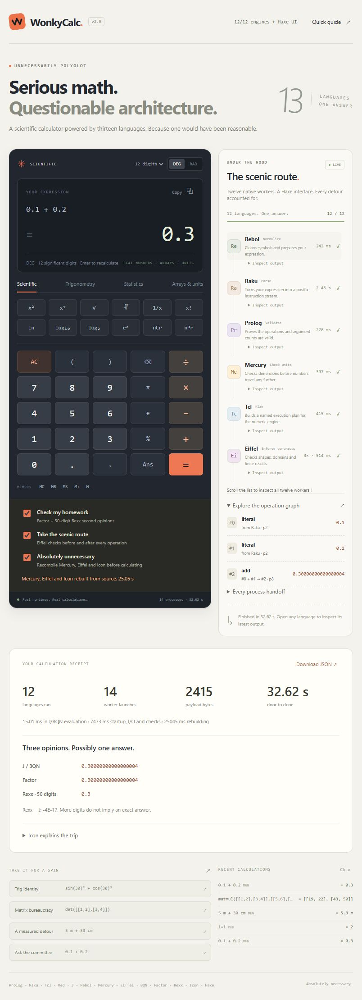
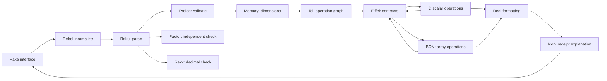

# WonkyCalc

**Thirteen languages. One calculator. Absolutely necessary.**

A scientific calculator with twelve native language workers and a browser interface written in **Haxe**. It handles scientific functions, statistics, vectors, matrices and units. The scenic-route sidebar shows real worker activity, intermediate output, operation dependencies and the overhead incurred getting an answer.



## Run it

Supported: **Windows x64**. Install [Node.js 20+](https://nodejs.org/), [Python 3 with Tcl/Tk](https://www.python.org/downloads/windows/) on PATH, and [Visual Studio / Build Tools](https://visualstudio.microsoft.com/downloads/) with **Desktop development with C++**. The C compiler builds Regina Rexx. Windows Installer is needed to extract the archive utility.

```powershell
npm run setup
npm start
```

Open **http://localhost:3210**. After setup, double-click **WonkyCalc.cmd** to start a hidden local server and open the browser. Stop that server with `powershell -File scripts/stop.ps1`; stop `npm start` with Ctrl+C.

**First setup is substantial.** Mercury is built from source in a project-local MSYS2 environment. This can take 10–30 minutes or more; the toolchains require several gigabytes of disk space. Progress logs are `.cache/mercury-configure.log`, `mercury-build.log` and `mercury-install.log`. Normal startup does not rebuild runtimes.

Setup checks pinned SHA-256 hashes, extracts tools under `.runtimes/`, builds workers under `.cache/bin/` and compiles Haxe into `public/app.js`. It does not add tools to your system PATH or install them system-wide. MSYS2's compiler packages come from its signed repositories inside the project-local environment; those package versions are not frozen. Internet is needed for setup; calculations work offline afterward.

## What it calculates

- Arithmetic, powers, percentages, factorials, π / τ / e and full-precision Ans.
- Roots, reciprocal, exponential, natural/base-10/base-2/custom-base logarithms.
- Trigonometric, inverse trigonometric, hyperbolic and inverse hyperbolic functions, `atan2`, DEG/RAD modes and angle conversions.
- Combinations, permutations, GCD, LCM, modulo, absolute value, floor, ceiling and rounding.
- Sum, mean, median, min/max, population variance/standard deviation and hypotenuse.
- Vectors and rectangular matrices: elementwise arithmetic, dot products, matrix multiplication, transpose, determinant, norm and array sum/mean/min/max.
- Units: **m, cm, km, kg, g, s, ms, seconds**. Mercury checks dimensions; results use SI base units.
- Display precision, scalar memory, browser-local history, full-precision copy and downloadable calculation receipts.

```text
sin(30)^2 + cos(30)^2                     → 1          (DEG)
ncr(52,5)                                → 2598960
stdev(2,4,4,4,5,5,7,9)                    → 2
dot([1,2,3],[4,5,6])                      → 32
det([[1,2],[3,4]])                        → -2
matmul([[1,2],[3,4]],[[5,6],[7,8]])         → [[19,22],[43,50]]
5 m + 30 cm                              → 5.3 m
10 m / 2 s                               → 5 m s^-1
5 m + 3 seconds                          → incompatible units
```

Use explicit multiplication: `2*pi`. Exponents associate right: `2^3^2 = 512`. Unary minus follows conventional precedence: `-2^2 = -4`. `%` divides by 100, including in addition: `200+10% = 200.1`. `atan2(y,x)` uses that argument order. `round` rounds halves away from zero. Variance and standard deviation describe a **population**.

The primary result uses real floating-point arithmetic, approximately 15–16 significant digits. Red rounds the display independently. Ans and memory retain the last **dimensionless scalar** result; array and unit results remain in history and can be copied. Factorial/combinatorics accept integers through 170. Expressions allow 1,024 characters and 256 instructions; functions accept at most 64 arguments. Arrays allow two dimensions and 256 elements, subject to the expression limit. Determinants are at most 6×6. Array summaries take one array; scalar statistics take comma-separated arguments.

Attaching a unit to an already dimensioned quantity is rejected. Unit-bearing powers need a literal integer exponent from −32 to 32; roots must leave integer unit exponents, and intermediate unit exponents stay within ±1,024. Scientific functions on arrays are limited to the array operations listed above. Complex arithmetic, symbolic algebra, plotting and affine temperature units are outside this version.

## Turn up the bureaucracy

**Check my homework** runs Factor and Rexx independently on Raku's instruction stream. Factor covers basic arithmetic, powers, square roots, rounding bounds, sums/means/min/max and unit scaling. Rexx covers decimal arithmetic, integer powers, factorials, rounding, sums/means/min/max and unit scaling with `NUMERIC DIGITS 50`. Unsupported functions, matrices and transcendental constants are explicitly labelled. Neither checker borrows J's answer; Rexx reads it only after computing its own answer, to report the difference. Fifty decimal digits do not make repeating fractions exact.

**Take the scenic route** launches Eiffel before and after every operation. Every numerical operation already gets a fresh J or BQN process. Switching scenic mode off keeps required array checks and final result validation, but removes extra scalar contracts.

**Absolutely unnecessary** recompiles the Mercury, Eiffel and Icon workers into an isolated directory before each calculation. The interface reports real compilation time. It does not reinstall or rebuild language compilers.

The expandable graph connects operands to operations and links each result to its recorded handoff. Download the JSON receipt to inspect the complete graph, outputs, timings and independent answers.

## Who does what



| Language | Source                  | Responsibility                                                              |
| -------- | ----------------------- | --------------------------------------------------------------------------- |
| Rebol    | `workers/normalize.reb` | Normalize symbols and whitespace.                                           |
| Raku     | `workers/parse.raku`    | Grammar, precedence, arrays, units and postfix instructions.                |
| Prolog   | `workers/validate.pl`   | Function/arity relations and stack validity.                                |
| Mercury  | `workers/units.m`       | Typed dimension propagation and unit compatibility.                         |
| Tcl      | `workers/plan.tcl`      | Per-operation J programs and dependency edges.                              |
| Eiffel   | `workers/contracts/`    | Executable contracts, shapes, domains and finite results.                   |
| J        | `workers/engine.ijs`    | Scalar scientific arithmetic; audit a component for pure array expressions. |
| BQN      | `workers/array.bqn`     | Vectors/matrices; audit the final shape and finiteness.                     |
| Factor   | `workers/check.factor`  | Independent supported scalar evaluation.                                    |
| Rexx     | `workers/decimal.rexx`  | Independent 50-digit decimal evaluation and differences.                    |
| Red      | `workers/format.red`    | Decimal-string rounding of every result component.                          |
| Icon     | `workers/explain.icn`   | Readable explanation from the actual handoff log.                           |
| Haxe     | `frontend/Main.hx`      | The complete interactive browser application.                               |

`public/app.js` is generated by Haxe and marked generated for GitHub statistics. Remaining handwritten JavaScript implements local HTTP transport, process orchestration and tests. Python embeds real Tcl and performs no calculator arithmetic. There is no JavaScript fallback calculator or simulated worker activity.

The sidebar's twelve engines are runtime workers. Haxe is the thirteenth source language, compiled to JavaScript for the browser; it is not counted as a fresh native process on every click.

## Reading the receipt

- **Languages ran:** unique workers actually invoked. Disabling homework skips Factor/Rexx, giving ten.
- **Worker launches:** direct worker invocations, including Python hosting Tcl. Compiler processes and their children are excluded.
- **Payload bytes:** declared worker input/output files, including generated J plans and excluding installed worker source and OS overhead. Repeated handoffs count repeated transfers.
- **Numeric time:** measured inside J/BQN evaluation. Other worker time includes startup, I/O, contracts, cross-checks, formatting and explanations; it is not a pure OS startup measurement.
- **Build time:** separate wall time recompiling Mercury, Eiffel and Icon.

Icon explains handoffs preceding its own invocation; the receipt also records Icon itself. Literal graph nodes originate in Raku and do not pretend to launch a numerical process.

## Development

```powershell
npm run build    # Compile Haxe and the three native project workers
npm run doctor   # Discover twelve workers and run a scientific smoke test
npm test         # Scientific, array, unit, contract, transport and isolation tests
```

Each calculation gets an isolated temporary directory, cleaned on success or failure. User text is parsed as data; numerical worker code uses whitelisted operations and validated literals. Workers run without user-controlled shell interpolation, have timeouts and are cancelled on disconnect. The server binds to loopback, checks Host/Origin, limits input size and permits three simultaneous calculations. It is a local application.

Custom executables can be set in ignored `runtime.local.json`, with keys `rebol`, `raku`, `prolog`, `tcl`, `python`, `j`, `red`, `factor`, `rexx`, `bqn`, `mercury`, `eiffel`, `icon`, or matching `WONKYCALC_*` environment variables. The last three point to compiled project workers, not compilers. Unnecessary mode uses the project-local toolchains. Set `PORT` to change the port.

Use Jsoftware's `jconsole`, not Java's unrelated program. Mercury's `mmc` also shares its name with Windows Management Console; scripts select the project-local compiler. Other operating systems are not verified.

## Toolchain sources

- [Rakudo 2026.09](https://rakudo.org/downloads/), [SWI-Prolog 10.0.2-1](https://www.swi-prolog.org/download/stable), [J build96](https://github.com/jsoftware/jsource/releases/tag/build96).
- [Rebol/Bulk 3.22.1](https://github.com/Oldes/Rebol3/releases/tag/3.22.1), [Red CLI 0.6.6](https://www.red-lang.org/p/download.html), Tcl 8.6 from Python.
- [Factor 0.102](https://github.com/factor/factor/releases/tag/0.102), [CBQN 0.12.0 Windows build](https://github.com/vylsaz/cbqn-win-docker-build/releases/tag/cbqn-0.12.0), linked by [BQN's running guide](https://mlochbaum.github.io/BQN/running.html).
- [Mercury 22.01.9](https://dl.mercurylang.org/), [Gobo Eiffel 26.10](https://github.com/gobo-eiffel/gobo/releases/tag/gobo-26.10) with its Zig C backend.
- [Unicon 13.2](https://github.com/uniconproject/unicon/releases/tag/13.2): its Icon compiler runs our Icon source.
- [Regina Rexx 3.9.5 source mirror, pinned commit](https://github.com/0branch/regina/tree/9ad07276c9846f0f23a27512eabca1cc8a7b857b), built with MSVC because the binary mirror was unavailable during development.
- [Haxe 4.3.7](https://github.com/HaxeFoundation/haxe/releases/tag/4.3.7), [MSYS2 base 2026-09-27](https://github.com/msys2/msys2-installer/releases/tag/2026-09-27), [innoextract 1.9](https://github.com/dscharrer/innoextract/releases/tag/1.9), and 7-Zip.

Runtime URLs and hashes are in `scripts/download-runtimes.ps1` and `scripts/extra-runtimes.json`. WonkyCalc is MIT-licensed. Downloaded runtimes retain their upstream licenses and stay outside the repo, along with caches and calculation data.
