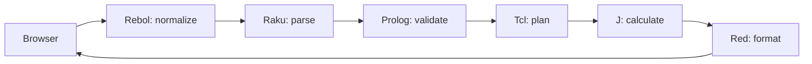

# WonkyCalc

**Six languages. One answer. Absolutely necessary.**

A scientific calculator that sends every expression through **Rebol → Raku → Prolog → Tcl → J → Red**. Real interpreters, separate processes, measurable overhead. A live sidebar shows each stage running, its actual elapsed time, and the intermediate output it produced.

The calculator looks reasonably normal. Its architecture is less reasonable.


## Run it

The supported setup is **Windows x64**, with [Node.js 20+](https://nodejs.org/) and [Python 3 with Tcl/Tk](https://www.python.org/downloads/windows/) installed and available on PATH. Python's Windows installer includes Tcl/Tk by default.

```powershell
npm run setup
npm start
```

Open **http://localhost:3210**. No npm packages or build step are required.

After setup, you can also double-click **WonkyCalc.cmd**. It starts a hidden local server and opens your browser. Run `powershell -File scripts/stop.ps1` to stop a server started by the launcher. With `npm start`, use Ctrl+C.

Setup downloads official runtime distributions into `.runtimes/`, checks pinned SHA-256 hashes, and unpacks them locally. It does not add runtimes to PATH or install them system-wide. SWI-Prolog's installer is extracted using a local 7-Zip administrative image. Windows Installer must be available for that extraction. Dependencies need an internet connection once; the calculator then works offline.

## What it calculates

- Arithmetic, parentheses, powers, percentage, factorial, constants π / τ / e, and full-precision Ans.
- Roots, reciprocal, exponential, natural/base-10/base-2/custom-base logarithms.
- Trigonometric, inverse trigonometric, hyperbolic, inverse hyperbolic, and `atan2` functions; DEG/RAD mode and angle conversions.
- Combinations, permutations, GCD, LCM, and modulo.
- Sum, mean, median, min/max, population variance and standard deviation, and hypotenuse/norm.
- Absolute value, floor, ceiling, and rounding.
- Selectable display precision; memory (MC/MR/MS/M+/M−); browser-local history; full-precision copy.

Examples:

```text
sin(30)^2 + cos(30)^2       → 1         (DEG)
ncr(52,5)                  → 2598960
mean(4,8,15,16,23,42)      → 18
stdev(2,4,4,4,5,5,7,9)     → 2
root(-32,5)                → -2
logn(81,3)                 → 4
```

Use `*` for multiplication: `2*pi`. Exponents associate to the right, so `2^3^2 = 512`; unary minus follows conventional precedence, so `-2^2 = -4`. `%` means division by 100, including in addition: `200+10% = 200.1`. `atan2(y,x)` uses that argument order. `round` rounds halves away from zero. Statistics use comma-separated arguments; variance and standard deviation describe the **population**.

This version uses real numbers and approximately 15–16 significant digits of internal floating-point precision. Display rounding is performed separately and never changes Ans or memory. Factorial and combinatorics are limited to integer inputs through 170; statistics accept 1–64 values. Expressions are limited to 1,024 characters and 256 parser instructions. It does not implement symbolic algebra, complex arithmetic, or graphing. Overflow and invalid domains produce explicit errors in the sidebar.

## The unnecessarily long route



| Language | Source | Actual responsibility |
| --- | --- | --- |
| Rebol | `workers/normalize.reb` | Converts Unicode operators, normalizes case/whitespace, and checks basic input limits. |
| Raku | `workers/parse.raku` | Parses the expression with a grammar and compiles it into postfix instructions with correct precedence. |
| Prolog | `workers/validate.pl` | Applies operation/arity relations and proves stack validity before execution. |
| Tcl | `workers/plan.tcl` | Builds named J instructions from the validated stack and inserts constants, angle mode, and Ans. |
| J | `workers/engine.ijs` | Performs all numerical evaluation and mathematical domain checks. |
| Red | `workers/format.red` | Rounds and renders the answer at the requested significant-digit precision. |

HTML/CSS/JavaScript provide the browser interface. A dependency-free Node server transports requests and streams real worker events as NDJSON. `scripts/tcl-host.py` embeds the actual Tcl interpreter supplied with Python; it does no parsing or mathematics. There is **no JavaScript fallback calculator** and no simulated language activity.

Typing and keypad entry compose an expression locally. Pressing **= / Enter**, selecting a sample, or using M+/M− starts the language pipeline. Invalid expressions stop at the stage that rejects them; later stages are not claimed to have run. Every successful calculation starts six fresh processes, because optimizing that away would miss the point.

## Development and verification

```powershell
npm run doctor   # Runtime discovery plus a six-language scientific smoke test
npm test         # Numerical regressions, error domains, precision, and isolation
```

Each calculation gets its own temporary directory, which is cleaned after success or failure. User input is parsed as data. The Tcl planner only emits allowlisted operations and validated numeric literals; there is no eval of user expressions. Processes run without shell interpolation, have timeouts, and terminate when a request is disconnected. The server binds to loopback only, checks Host/Origin, limits input size, and permits at most three simultaneous calculations. It is a local application, not a hardened public math service.

For custom runtime installations, create an ignored `runtime.local.json`:

```json
{
  "rebol": "C:/tools/rebol.exe",
  "raku": "C:/tools/rakudo/bin/raku.exe",
  "prolog": "C:/tools/swipl/bin/swipl.exe",
  "tcl": "C:/tools/tcl/bin/tclsh.exe",
  "j": "C:/tools/j/bin/jconsole.exe",
  "red": "C:/tools/red-cli.exe"
}
```

Use Jsoftware's `jconsole`, not Java's unrelated executable with the same name. Setting `tcl` uses a standalone interpreter and removes the need for Python. Individual paths can also be set with `WONKYCALC_REBOL`, `WONKYCALC_RAKU`, `WONKYCALC_PROLOG`, `WONKYCALC_TCL`, `WONKYCALC_J`, `WONKYCALC_RED`, or `WONKYCALC_PYTHON`. Set `PORT` to change the local port.

Other operating systems may work with compatible runtimes and explicit paths, but the installer and launcher are Windows-specific and other platforms are not currently verified.

## Runtime sources

- [Rakudo 2026.09](https://rakudo.org/downloads/)
- [SWI-Prolog 10.0.2-1](https://www.swi-prolog.org/download/stable)
- [Jsoftware J engine, build96](https://github.com/jsoftware/jsource/releases/tag/build96)
- [Oldes Rebol/Bulk 3.22.1](https://github.com/Oldes/Rebol3/releases/tag/3.22.1)
- [Red CLI 0.6.6](https://www.red-lang.org/p/download.html)
- Tcl 8.6, supplied by Python's Windows distribution (or your own `tclsh`).

WonkyCalc's source is MIT-licensed. Downloaded runtimes retain their own upstream licenses and are excluded from the repository, along with caches, calculation data, and local machine paths.
